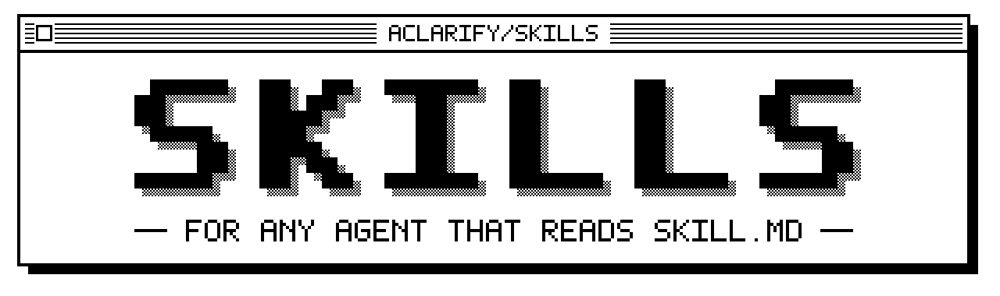

<div align="center">

<picture>
  <source media="(prefers-color-scheme: dark)" srcset="docs/assets/logo-dark.svg">
  
</picture>

<p><b>Agent skills for planning, investigating, building, writing and measuring your own harness.</b></p>

<p><sub>Claude Code · Codex · Copilot · Cursor · OpenCode · and more</sub></p>

<p>
  <a href="https://github.com/spencermarx/skills/releases"></a>
  <a href="LICENSE"></a>
  <a href="https://github.com/spencermarx/skills/actions/workflows/ci.yml"></a>
</p>

<p>
  <a href="#install">Install</a> ·
  <a href="#start-here">Start here</a> ·
  <a href="#catalog">Catalog</a> ·
  <a href="#how-it-works">How it works</a> ·
  <a href="#contributing">Contributing</a>
</p>

</div>

A skill is a folder of instructions that your agent loads when a task matches
it. Ask for a plan review and `grill-me` interviews you, one round at a time,
until every branch is settled. Hit a bug nobody can explain and
`first-principles-investigation` tests rival causes against the real system
until one survives. The [catalog](#catalog) has the rest.

- **Portable.** Each skill describes actions ("read the file", "run in the
  shell") rather than naming one harness's tools, so it reads the same in
  Claude Code, Codex, Copilot, Cursor or OpenCode.
- **Method, not product.** A skill teaches a kind of work, such as interviewing
  a plan or investigating a failure. It joins the catalog only when it fixes a
  failure someone watched an agent make.
- **Configured by your repository.** Skills read `docs/agents/` for where your
  issues, glossary and decisions live, and fall back to defaults they state.
- **Measured.** Routing evals check that a skill fires when it should and stays
  quiet when it should not. A new skill leaves incubation once it has been used
  for real and its evals pass.

## Install

> [!WARNING]
> Pick one route per harness. Installing through two routes loads every skill twice.

<details open>
<summary><b>Claude Code</b></summary>

```bash
claude plugin marketplace add spencermarx/skills
claude plugin install aclarify-skills@aclarify
claude plugin install ocr@aclarify   # optional: Open Code Review
```

The plugin follows `main`. To follow releases instead, add the marketplace as
`spencermarx/skills#stable`.

If you added the Open Code Review marketplace before, it has the same name,
`aclarify`. Remove it first with `claude plugin marketplace remove aclarify`.

</details>

<details>
<summary><b>Codex</b></summary>

```bash
codex plugin marketplace add spencermarx/skills --ref stable
codex plugin add aclarify-skills@aclarify
```

`--ref stable` follows releases. `--ref v<version>` pins one from
[Releases](https://github.com/spencermarx/skills/releases).

</details>

<details>
<summary><b>Copilot</b> <sub>CLI and VS Code</sub></summary>

```bash
copilot plugin marketplace add spencermarx/skills
copilot plugin install aclarify-skills@aclarify
```

Copilot CLI reads the same marketplace. In VS Code, use the `npx skills` route
below with `-a github-copilot`.

</details>

<details>
<summary><b>Cursor, OpenCode, Gemini CLI, Windsurf, Amp, Cline and others</b></summary>

```bash
npx skills@latest add spencermarx/skills#stable -a <agent>
```

Replace `<agent>` with your harness's id, such as `cursor`, `opencode`,
`gemini-cli`, `windsurf`, `amp` or `cline`. An unknown id prints the full list.
`#stable` follows releases. `#v<version>` pins one from
[Releases](https://github.com/spencermarx/skills/releases).

</details>

### Set up each repository

Run the `setup-aclarify-skills` skill once in each repository. It starts only
when you call it by name, as `/setup-aclarify-skills`. It shows you a draft
before it writes anything, and it:

- asks where your issues, glossary, decision records and scratch files live;
- writes the answers to `docs/agents/` and adds an `## Agent skills` block to
  `AGENTS.md` that points every harness there;
- checks the tools some skills need, such as the `ocr` CLI for code review, and
  installs one only after you agree.

Run it again with `check` to re-check the tools and change nothing else.

> [!TIP]
> Every skill runs before setup, on defaults it states. A few also need a tool
> installed, and [Compatibility](#compatibility) says which.

## Start here

Type a skill as a command, or describe the job and let your agent choose.
The Claude Code plugin also accepts the full name, such as
`/aclarify-skills:grill-me`, when another skill shares the short one.

| When you want to | Type |
|:---|:---|
| Settle a plan before anyone builds it | [`/grill-me`](skills/planning/grill-me) |
| Find the cause of a failure nobody can explain | [`/first-principles-investigation`](skills/engineering/first-principles-investigation) |
| Build a feature or fix a bug test-first | [`/tdd`](skills/engineering/tdd) |
| Stop relitigating a settled choice | [`/decision-record`](skills/planning/decision-record) |
| Pick the work up in a fresh session | [`/handoff`](skills/core/handoff) |

<details>
<summary><b>What a <code>grill-me</code> round looks like</b></summary>

<br>

`/grill-me we're moving auth from sessions to JWTs`

The agent asks every question it can settle now, each with its recommended
answer, then waits for yours. An abridged example round:

> ❓ **Q1** - **Token lifetime**: Should access tokens expire after 15 minutes,
> with a refresh token to renew them?
>
> ➡️ Yes. A leaked token stops working within 15 minutes, at the cost of one
> refresh endpoint.
>
> ---
>
> ❓ **Q2** - **Where the token lives**: Should the browser keep it in an
> httpOnly cookie rather than local storage?
>
> ➡️ Yes. Scripts on the page cannot read the cookie, so a cross-site scripting
> bug cannot steal the token.

Answer "yes" to accept a recommendation. Each answer opens the questions that
depended on it, and the next round asks those. The interview ends when nothing
is left to decide.

</details>

### Skills that work together

The skills name each other, so one hands its work to the next where it is
installed.

- `grill-me` → `domain-modeling` → `decision-record`, run in order by
  `grill-with-docs`: settle a plan, then record its terms and decisions.
- `triage` → `first-principles-investigation` → `grill-with-docs`: verify an
  issue, find its cause, then shape it into an agent-ready brief.
- `gather-argument-material` → `draft-argued-piece` → `humanize` →
  `seven-copy-critics`: collect material, draft the piece, restore your voice,
  then test it against hostile readers.

## Catalog

Skills marked <kbd>/</kbd> start only when you type them. The rest also start
when a task matches.

| Family | For |
|:---|:---|
| [Core](#core) | Setting a repository up, keeping working files out of git, writing for a reader and handing work over |
| [Planning](#planning) | Settling a plan before anyone builds it, and recording what was settled |
| [Engineering](#engineering) | Finding the cause, building test-first, committing cleanly and taking a pull request to green |
| [Writing](#writing) | Gathering the material, drafting the argument or the ask, then checking it |
| [Strategy](#strategy) | Testing demand, ranking options, reviewing a plan and gating a launch |
| [Visual](#visual) | Product interfaces, the brand kit and slide decks |
| [Harness](#harness) | Building, measuring and maintaining the skills and conventions your agents read |
| [Incubating](#incubating) | Public beta skills, installed only by name |

### Core

| Skill | Use it to |
|:---|:---|
| [`setup-aclarify-skills`](skills/core/setup-aclarify-skills) <kbd>/</kbd> | Configure a repository for these skills and the tools they need |
| [`conveying-clearly`](skills/core/conveying-clearly) | Write a message a colleague reads once and acts on, point first |
| [`scratchpad`](skills/core/scratchpad) | Keep working files in one git-ignored folder, and find or clean them later |
| [`handoff`](skills/core/handoff) | Compact a session into a document a fresh agent can resume from |
| [`create-report`](skills/core/create-report) | Render a markdown record as a self-contained visual HTML report |

<sub>[Back to catalog](#catalog)</sub>

### Planning

| Skill | Use it to |
|:---|:---|
| [`grill-me`](skills/planning/grill-me) | Interview you about a plan, one round of questions at a time, until every branch settles |
| [`grill-with-docs`](skills/planning/grill-with-docs) | Grill a plan, then record what it settled as glossary entries and decision records |
| [`domain-modeling`](skills/planning/domain-modeling) | Pin down a project's vocabulary and spot the design decisions worth recording |
| [`decision-record`](skills/planning/decision-record) | Propose a decision record for a hard-to-reverse choice, and write it on your yes |
| [`wayfinder`](skills/planning/wayfinder) <kbd>/</kbd> | Chart work too big for one session as a map of decision tickets, then resolve them |
| [`to-questionnaire`](skills/planning/to-questionnaire) <kbd>/</kbd> | Turn a decision you can't answer alone into a questionnaire for someone who can |
| [`teach`](skills/planning/teach) <kbd>/</kbd> | Teach you a skill or concept over several sessions, with lessons and checks |

<sub>[Back to catalog](#catalog)</sub>

### Engineering

| Skill | Use it to |
|:---|:---|
| [`first-principles-investigation`](skills/engineering/first-principles-investigation) | Test competing hypotheses against the real system until one cause survives |
| [`prototype`](skills/engineering/prototype) | Build a throwaway prototype that answers one design question |
| [`arch-board`](skills/engineering/arch-board) | Convene expert personas to debate a hard design fork and return a cited verdict |
| [`tdd`](skills/engineering/tdd) | Build test-first in a red-green loop that produces behaviour tests worth keeping |
| [`write-comments`](skills/engineering/write-comments) | Write comments as you code that capture intent, invariants and gotchas |
| [`clean-comments`](skills/engineering/clean-comments) | Audit existing comments so each says what the code cannot |
| [`atomic-commits`](skills/engineering/atomic-commits) | Split a mixed changeset into atomic conventional commits |
| [`ocr-review-loop`](skills/engineering/ocr-review-loop) | Loop Open Code Review's review and address steps on a pull request until it approves |
| [`watch-ci`](skills/engineering/watch-ci) | Watch a CI or deploy run to its verdict and, with your OK, fix failures until green |
| [`triage`](skills/engineering/triage) | Move issues and outside pull requests through triage states to an agent-ready brief |
| [`ubiquitous-language`](skills/engineering/ubiquitous-language) | Create and maintain a repository's glossary files and map, never overwriting one |

<sub>[Back to catalog](#catalog)</sub>

### Writing

| Skill | Use it to |
|:---|:---|
| [`gather-argument-material`](skills/writing/gather-argument-material) | Interview you and collect raw fragments for a piece, before any outline |
| [`draft-argued-piece`](skills/writing/draft-argued-piece) | Draft an essay, post or guide block by block from the collected material |
| [`draft-conversion-copy`](skills/writing/draft-conversion-copy) | Draft a cold email, landing page or ad: copy that makes an ask |
| [`humanize`](skills/writing/humanize) | Rewrite text so it reads as its author wrote it, then check it blind |
| [`seven-copy-critics`](skills/writing/seven-copy-critics) | Stress-test marketing copy against seven hostile reader personas and rebuild it |

<sub>[Back to catalog](#catalog)</sub>

### Strategy

| Skill | Use it to |
|:---|:---|
| [`strategic-brief`](skills/strategy/strategic-brief) | Test demand for an undrafted idea, write the brief and call go or no-go |
| [`rice-prioritization`](skills/strategy/rice-prioritization) | Rank candidates with a deterministic RICE calculator, then pressure-test the scores |
| [`ceo-review`](skills/strategy/ceo-review) | Review a drafted plan from one committed stance on eight business dimensions |
| [`campaign-brief`](skills/strategy/campaign-brief) | Challenge a campaign brief on six dimensions before launch, then call go or no-go |
| [`brand-review`](skills/strategy/brand-review) | Score finished marketing creative against the brand and list fixes by priority |

<sub>[Back to catalog](#catalog)</sub>

### Visual

| Skill | Use it to |
|:---|:---|
| [`get-brand-kit`](skills/visual/get-brand-kit) | Look up colours, type, logos and voice in your brand kit (ships a placeholder) |
| [`design-expert`](skills/visual/design-expert) | Audit, redesign and polish a product interface on your brand kit and design system |
| [`create-html-slides`](skills/visual/create-html-slides) | Build a branded 16:9 slide deck as one self-contained HTML file, with optional PDF |

<sub>[Back to catalog](#catalog)</sub>

### Harness

| Skill | Use it to |
|:---|:---|
| [`skill-builder`](skills/harness/skill-builder) | Author, refactor, split or port a skill so it is portable and fires when it should |
| [`writing-for-agents`](skills/harness/writing-for-agents) | Word skill descriptions and instructions so agents find the right context |
| [`harness-eval`](skills/harness/harness-eval) | Measure whether skills fire when they should, with routing evals and static checks |
| [`session-retro`](skills/harness/session-retro) | Read an agent session back and propose fixes by severity, each where it belongs |
| [`add-standard`](skills/harness/add-standard) | Turn "we should always X" into one written, routed convention |
| [`standards`](skills/harness/standards) | Route, change or retire a written convention and keep every pointer to it in step |
| [`wizard`](skills/harness/wizard) | Generate an interactive shell wizard for the steps only a human can do |

<sub>[Back to catalog](#catalog)</sub>

### Incubating

> [!NOTE]
> Public beta. A bare `npx skills add` leaves these out and the plugin does not
> list them. Install one by name:
> `npx skills add spencermarx/skills#stable --skill <name>`.

| Skill | Use it to |
|:---|:---|
| [`whiteboard`](skills/_incubating/whiteboard) | Draw on a live tldraw board with your agents, in your browser |

`whiteboard` needs Node.js 22.12 or newer. On first use it installs tldraw, Vite
and Playwright's Chromium (about 150 MB), after asking. tldraw is under
[its own licence](https://github.com/tldraw/tldraw/blob/main/LICENSE.md), which
allows use in a local development environment.

<sub>[Back to catalog](#catalog)</sub>

## How it works

You install the skills once per harness. Each repository keeps its own settings,
which setup writes.

```text
 EACH HARNESS              EACH REPOSITORY
 install once              run once
 plugin or npx skills ───▶ setup-aclarify-skills
                               │ writes
                               ▼
                           AGENTS.md
                             ## Agent skills    points every harness
                                                at docs/agents/
                           docs/agents/
                             issue-tracker.md   where issues live
                             triage-labels.md   a label per triage role
                             domain.md          glossary, decision records
                             workspace.md       scratch folder, conventions,
                                                brand kit, code review
                               │ read by
                               ▼
 a task matches a skill ─▶ the skill follows docs/agents/,
                           or its own stated defaults
```

Setup writes `triage-labels.md` only when `triage` is installed. Without setup,
skills use their defaults: `GLOSSARY.md` at the root, decision records in
`docs/adr/`, a git-ignored `.scratchpad/` and no issue tracker. The
[configuration contract in AGENTS.md](AGENTS.md#the-configuration-contract)
lists which skill reads which file.

## Compatibility

- The skills are written for Claude Code, Codex, Copilot (CLI and VS Code),
  Cursor and OpenCode, and best-effort for any other harness that reads
  `SKILL.md`.
- Most skills need nothing beyond your harness. Those that do say so in their
  `compatibility` field. For example, `ocr-review-loop` needs the `ocr` CLI,
  `watch-ci` needs the `gh` CLI and PDF export in `create-html-slides` needs
  Node.js. A skill installs software only after you agree.
- `harness-eval`'s static checks run in any harness. Its routing evals measure
  Claude Code only, need Node.js 22.22 or newer and cost money for every case.
- Release notes are in [CHANGELOG.md](CHANGELOG.md) and on
  [Releases](https://github.com/spencermarx/skills/releases).

## Credits

Several skills adapt open-source work. Each says so in its frontmatter, and
[NOTICE](NOTICE) carries the licences.

- [Matt Pocock's skills](https://github.com/mattpocock/skills) (MIT): the
  starting point for many skills, among them `grill-me`, `tdd`, `triage` and
  `wayfinder`.
- [linkedin-skills](https://github.com/sergebulaev/linkedin-skills) by Sergey
  Bulaev (MIT): the AI-tell catalogs in `humanize`.
- [anthropics/skills](https://github.com/anthropics/skills) (Apache-2.0):
  passages of skill-creator, paraphrased in `skill-builder`.

`write-comments` and `clean-comments` draw on John Ousterhout's _A Philosophy of
Software Design_. `first-principles-investigation` draws on Andreas Zeller's
_Why Programs Fail_ and David J. Agans' _Debugging_.

## Contributing

Read [SCOPE.md](SCOPE.md) before proposing a skill and [AGENTS.md](AGENTS.md)
before writing one. [CONTRIBUTING.md](CONTRIBUTING.md) has the process: open an
issue before a new skill or a change in what a skill does, run `npm test` and
add a changeset with `npx changeset`. Declined proposals are kept in
[.out-of-scope/](.out-of-scope/).

## Licence

MIT. See [LICENSE](LICENSE). Maintained by Spencer Marx at Aclarify.
